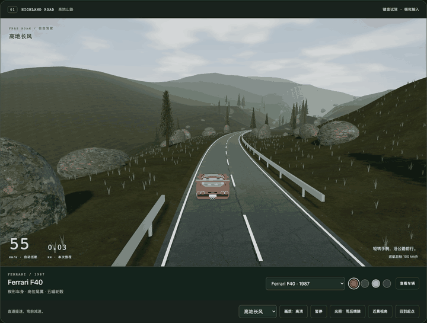
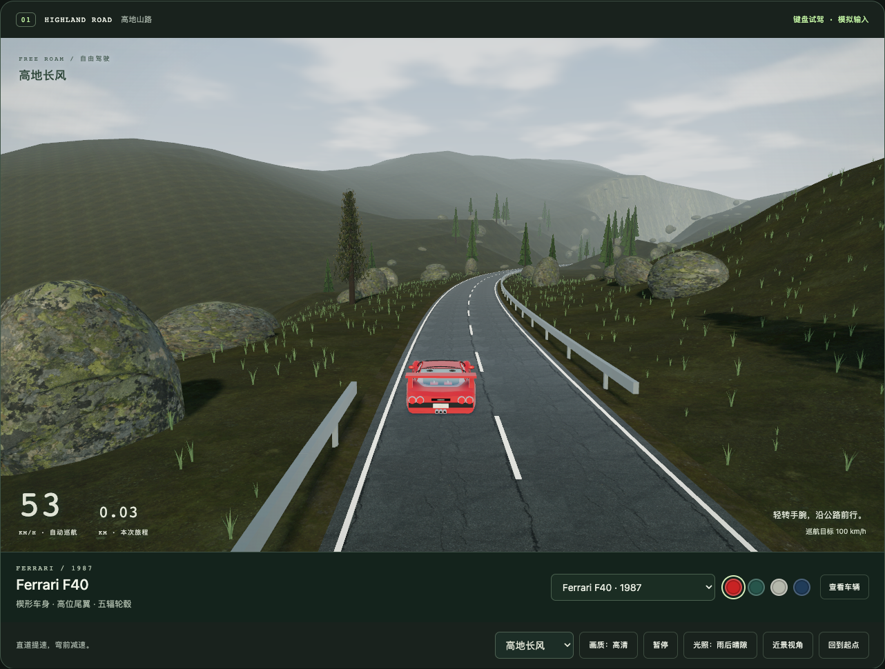
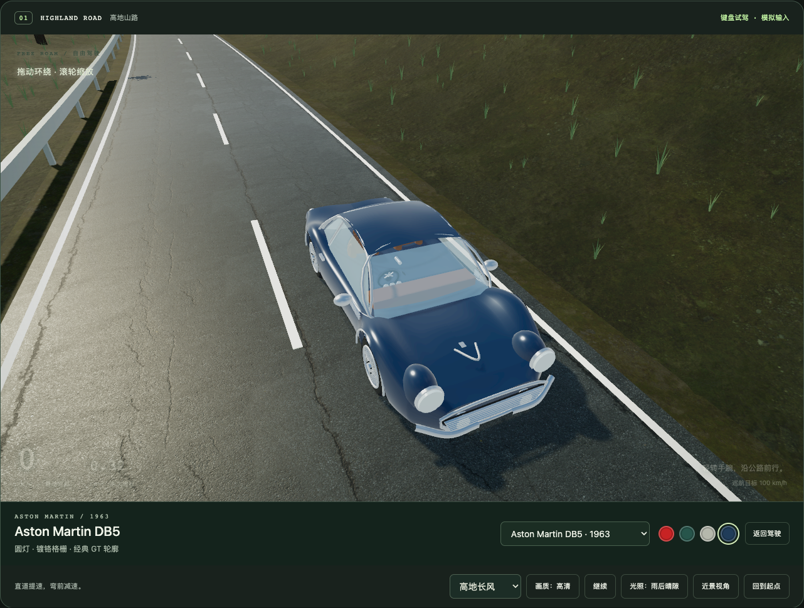
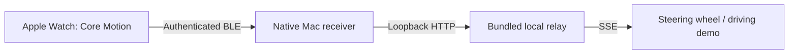

<p align="center"></p>

<h1 align="center">WatchSteer</h1>
<p align="center"><strong>Turn your Apple Watch into a steering wheel.</strong></p>
<p align="center">Raise your wrist. Calibrate. Steer.</p>
<p align="center"><a href="README.zh-CN.md">简体中文</a> · <a href="https://github.com/stephenzsl2007-del/watch-steer/releases">Download for Mac</a> · <a href="docs/SETUP.md">Setup</a> · <a href="docs/ARCHITECTURE.md">How it works</a></p>



*Included mountain-road demo, recorded with simulated keyboard input. This clip demonstrates the driving scene, not a recording of a physical Watch or a latency benchmark.*

WatchSteer turns wrist rotation into a continuous **−1 to +1 steering signal**, using a native watchOS app and a nearby Mac. The Watch connects directly over Bluetooth LE; everyday use needs no iPhone relay app, Wi-Fi setup or cloud account. A local service bundled with the Mac app feeds the visualizations.

## What it does

- **Steer with your wrist:** Core Motion attitude, adjustable steering axis, direction inversion and dead zone.
- **Set your center:** one-tap neutral calibration, with saved calibration and reference-frame checks when resuming.
- **Connect locally:** discover the Mac, authenticate once with a pairing token, remember the verified receiver and reconnect.
- **Use the signal:** a live 3D steering wheel and existing HTTP/SSE interfaces for your own local experiments.
- **Try a drive:** an optional Three.js mountain-road scene with cannon-es vehicle physics, elevation, lighting and a four-car procedural garage. The car cruises automatically; the Watch supplies steering.

## Demo: a wrist-controlled mountain drive



The driving scene is an example consumer of the steering signal. It includes forest bends, open highland straights, a stone village, suspension and roadside collisions. You can preview it with keyboard input before installing the Watch app. Input simulation is labeled in the interface.



Cars are original procedural interpretations inspired by the Ferrari F40 / 250 GTO and Aston Martin DB5 / DB9, not manufacturer models or licensed replicas.

## Quick start

### 1. Start the Mac receiver

Download the **Apple Silicon DMG** from [Releases](https://github.com/stephenzsl2007-del/watch-steer/releases), drag WatchSteer into Applications and open it. Allow Bluetooth when asked. The app contains its local service and driving assets; Python and Node are not needed to run the download.

This is an **experimental, ad-hoc signed build, not Apple-notarized**. macOS may require the documented [Open Anyway procedure](https://support.apple.com/guide/mac-help/open-a-mac-app-from-an-unknown-developer-mh40616/mac). No Developer ID identity is bundled. The build target is macOS 14+; the downloadable binary is arm64 only. See [validation](docs/VALIDATION.md) for the environment actually checked.

### 2. Install the Watch app

1. Download the source or clone this repository. Open `watch/WatchSteer.xcodeproj` in a compatible full Xcode.
2. Select your own **Signing Team** and a unique **Bundle Identifier**.
3. Enable Developer Mode and complete Xcode trust/device setup for the Watch and its paired iPhone. Select the physical Watch as the run destination, then Run.
4. In the Mac app, open **手表连接** → **复制配对令牌**. Paste the token into WatchSteer's Watch settings once, using the paired iPhone keyboard if helpful.
5. Choose **蓝牙直连**, tap **连接电脑**, select **WatchSteer Mac**, hold your neutral position and tap **校准正中** / **设为正中**.
6. Rotate your wrist. Start driving on the Mac, or inspect the live steering wheel.

The Watch build target is watchOS 10+. Initial hardware sessions used an Apple Watch Series 11 on watchOS 27.2.1; other hardware/OS combinations need validation. Use an Xcode version that supports your device OS. A personal Apple Account can be used for development signing, subject to Apple's provisioning restrictions.

**Keep the Watch app active.** Dimming, wrist-down, locking or backgrounding may interrupt motion delivery. Longer wake/return-to-clock settings do not grant continuous background execution. Stale Watch data pauses the car. This release does not claim to solve unattended or screen-off driving.

[Detailed setup and troubleshooting →](docs/SETUP.md)

### Preview without a Watch

With Python 3.10+:

```sh
git clone https://github.com/stephenzsl2007-del/watch-steer.git
cd watch-steer
python3 tools/build_web.py
python3 tools/run_local.py
```

Open **http://127.0.0.1:8765/** and choose **键盘试驾**. Use the arrow keys, or enable **本机演示** and drag the steering slider. Open through the local server; double-clicking the HTML file does not start the app or its live connection.

## How it works



The target is **50 Hz motion sampling** and at most **30 Hz BLE submission**, with latest-value queues and bounded in-flight packets. These are configuration targets, not measured end-to-end performance promises. Samples include calibration, freshness and timing metadata. The browser pauses driving after approximately 500 ms without fresh input.

The protocol uses a shared random pairing token, fresh mutual challenges, HMAC authentication, HKDF session keys and ChaCha20-Poly1305 payload encryption. The default service listens only on loopback. The browser receives read-only authorization through a short-lived, single-use ticket. Tokens are generated per installation and are not included in the repository or app bundle. This custom protocol has not had an independent security audit.

[Architecture and signal interface →](docs/ARCHITECTURE.md) · [Security boundaries →](SECURITY.md)

## Build and contribute

The receiver and Watch use Swift / SwiftUI. The local relay uses Python's standard library. Three.js, cannon-es and the material maps are included; the demo has no runtime CDN dependency.

```sh
# Source receiver; requires macOS, full Xcode and Python 3.10+
python3 tools/run_bluetooth.py

# Standalone Mac app; use Python 3.12 on an Apple Silicon Mac
python3.12 -m venv .venv
source .venv/bin/activate
python -m pip install -r requirements-build.txt
python tools/build_standalone.py
```

[Build/test instructions](docs/DEVELOPMENT.md) · [Validation status](docs/VALIDATION.md) · [Contributing](CONTRIBUTING.md)

## License and inspiration

Original code is [MIT licensed](LICENSE). Third-party code and assets keep their own licenses; see [THIRD_PARTY_NOTICES.md](THIRD_PARTY_NOTICES.md).

Inspired by small projects that repurpose Apple hardware, including [WatchPointer](https://github.com/umarz317/WatchPointer), [Watch Mouse](https://github.com/svrohith9/watch-mouse) and [airpodmouse](https://github.com/systemsoftware/airpodmouse). Their presentation and interaction ideas are references; WatchSteer is an independent project. Slow Roads informed the relaxed driving-demo direction; no Slow Roads code or assets are included. Not affiliated with Apple or the vehicle manufacturers.
