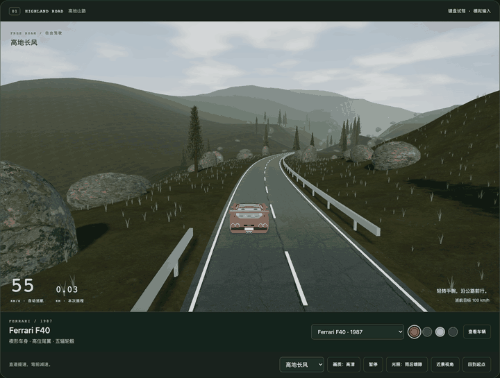
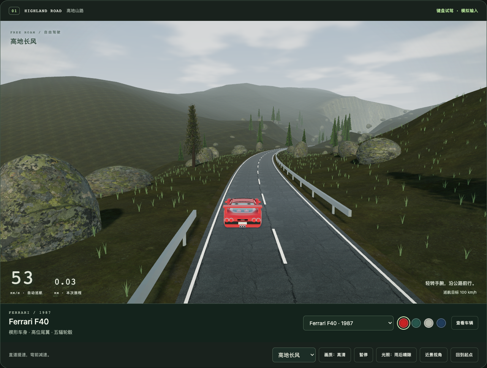
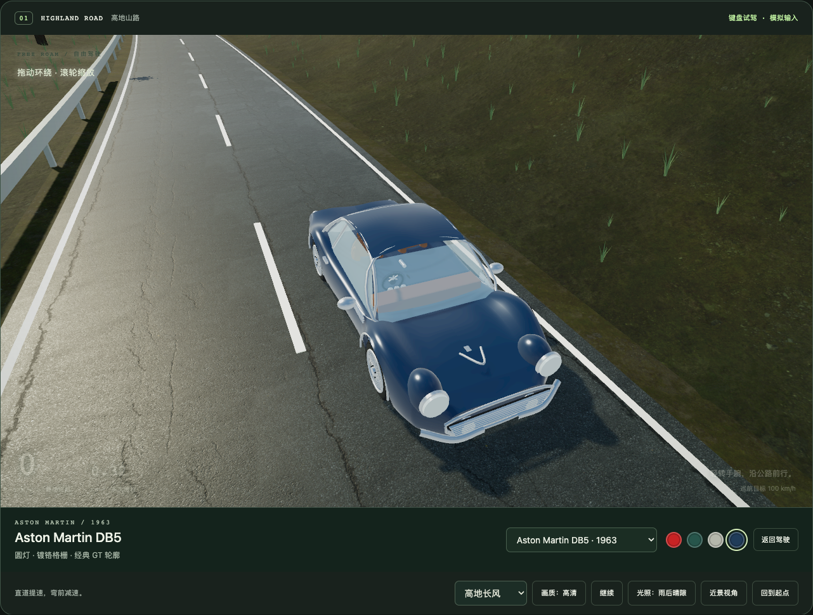

# WatchSteer

**把 Apple Watch 变成方向盘。抬腕、校准、转动。**

[English](README.md) · [Mac 下载](https://github.com/stephenzsl2007-del/watch-steer/releases) · [安装说明](docs/SETUP.md)



*这段动图使用键盘模拟输入录制，用来展示驾驶场景，不代表真实手表录像或延迟实测。*

WatchSteer 使用原生 watchOS App 读取手腕姿态，输出 **−1 到 +1 的连续转向值**，通过蓝牙直接发送给附近的 Mac。日常使用无需 iPhone 中转 App、填写 Wi-Fi 地址或云端账号。Mac 自带的本机服务将转向值送到三维方向盘和驾驶场景。

## 可以做什么

- 手腕转向：选择旋转轴、反转方向，带死区和滤波。
- 零点校准：一键设置正中，保存校准；恢复时检查参考系条件。
- 本地连接：发现附近 Mac，用配对令牌验证，记住已验证的电脑并重连。
- 复用信号：通过现有本机 HTTP / SSE 接口接入自己的可视化或实验。
- 山路试驾：Three.js 场景、cannon-es 悬挂和碰撞、起伏山路、光影及四款程序化经典跑车。小车自动巡航，手表负责转向。





车型是受 Ferrari F40、250 GTO、Aston Martin DB5、DB9 启发的原创程序化造型，并非厂商模型或授权复刻。

## 开始使用

1. 从 [Releases](https://github.com/stephenzsl2007-del/watch-steer/releases) 下载 Apple Silicon Mac 安装包，拖入 Applications 后打开，允许蓝牙。安装包内置本机服务和素材。
2. 下载源码，在 Xcode 中打开 `watch/WatchSteer.xcodeproj`，选择自己的签名团队并修改 Bundle Identifier。完成手表开发者模式、信任和设备连接，选择真实手表运行。
3. Mac 点击「手表连接 → 复制配对令牌」，在手表设置中输入一次；可使用配对 iPhone 的键盘辅助输入。
4. 手表选择「蓝牙直连」，点击「连接电脑」，选择 **WatchSteer Mac**。保持自然的中立姿势，点击「校准正中 / 设为正中」，然后转动手腕。
5. 在 Mac 开始驾驶，或查看连续转向值。左右相反时启用反转；转动方式不对时换轴并重新校准。

Mac 构建目标为 macOS 14+，安装包仅支持 Apple Silicon；手表构建目标为 watchOS 10+，初始真机测试使用 Series 11 / watchOS 27.2.1。其他组合尚需验证。安装包为实验版 ad-hoc 签名，未完成 Apple 公证，系统可能需要在「隐私与安全性」中选择打开。手表需要使用自己的 Apple 账号签名安装。

**手表 App 需要保持活跃。** 放下手腕、熄屏、锁定或切后台都可能让姿态采样暂停。「唤醒 70 秒」和「一小时后返回时钟」不等于授予持续后台运行能力。收到的数据超过约 500 ms 未更新，小车会暂停。本版不承诺持续熄屏驾驶。

## 没有手表也可以预览

需要 Python 3.10+：

```sh
python3 tools/build_web.py
python3 tools/run_local.py
```

在浏览器打开 **http://127.0.0.1:8765/**，点击「键盘试驾」，用左右方向键控制；也可以启用「本机演示」并拖动滑块。不要直接双击 HTML 文件。

## 实现方式

Apple Watch Core Motion → 经过验证和加密的 BLE → Mac 原生接收器 → 本机 Python 转发器 → SSE → 网页。

目标采样频率 50 Hz，BLE 提交上限 30 Hz；这些是设置值，不是端到端延迟保证。只保留最新值，限制等待确认的数据帧。令牌在每位用户本机生成，保存在应用数据目录和手表 Keychain，不随源码或安装包分发。本机服务默认仅监听回环地址。

[架构与接口](docs/ARCHITECTURE.md) · [详细安装与排错](docs/SETUP.md) · [开发与检查](docs/DEVELOPMENT.md) · [验证状态](docs/VALIDATION.md)

原创代码使用 [MIT](LICENSE) 许可；第三方引擎、摄影材质和运行时许可见 [THIRD_PARTY_NOTICES.md](THIRD_PARTY_NOTICES.md)。项目介绍参考了 [WatchPointer](https://github.com/umarz317/WatchPointer) 等硬件交互实验。WatchSteer 为独立项目，与 Apple 及车辆品牌无隶属关系。
